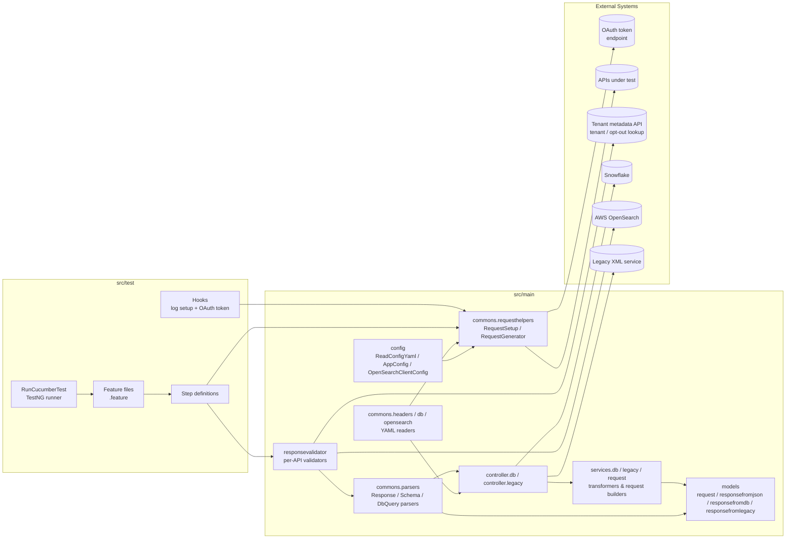
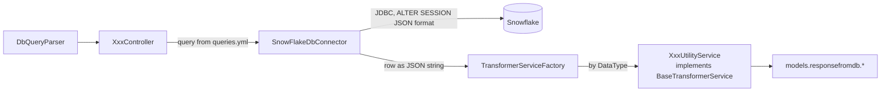
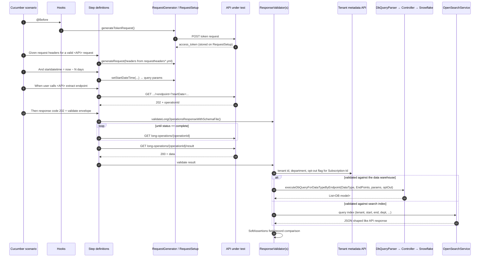

# Architecture — API Test Automation Framework

This document describes how the API automation framework is structured, how a test flows through it, and how to extend it. It is intended for engineers who write or maintain tests in this repository.

> Package, folder and API names below are illustrative. `<base-package>` stands for the project's root Java package, and `GetItems` is used as a sample API.

---

## 1. Purpose

The framework validates REST APIs end-to-end. For each API it:

1. Calls the real API over HTTP (extract endpoints with their *status* and *result* calls, and write-back `POST` endpoints).
2. Validates **contract** — HTTP status codes, response shape and error payloads against expected JSON stored in the repo.
3. Validates **data** — compares the API payload against an independent source of truth:
   - a **Snowflake** data warehouse for most extract and search endpoints,
   - **AWS OpenSearch** for date-range endpoints backed by search indices (v3 headers),
   - a **legacy XML service** for APIs still served from the legacy stack.

Tests are written in **Gherkin (Cucumber)**, wired with **Spring Boot** dependency injection, executed via **TestNG**, and HTTP calls are made with **REST Assured**.

---

## 2. Technology stack

| Concern | Technology | Version (pom.xml) |
|---|---|---|
| Language / build | Java, Maven (wrapper included) | 17 / 3.x |
| DI & configuration | Spring Boot (`spring-boot-starter`, `-data-jpa`, `-web`, `-test`) | 3.2.2 |
| BDD | Cucumber (`cucumber-java`, `cucumber-spring`, `cucumber-testng`) | 6.9.0 |
| Test runner | TestNG via `maven-surefire-plugin` + `surefire-testng` | 3.1.2 |
| HTTP client | REST Assured | 5.3.1 |
| Serialisation | Jackson (databind, XML, YAML, JSR-310), json-simple, SnakeYAML | 2.16.x |
| Data store (truth) | Snowflake JDBC + custom Hibernate `SnowflakeDialect` | 3.13.23 |
| Search store | `opensearch-java` + AWS SigV4 signing (`aws-java-sdk`) | 2.4.0 |
| Assertions | AssertJ `SoftAssertions`, TestNG `Assert` | — |
| Waiting | Awaitility | 4.2.0 |
| Boilerplate | Lombok | 1.18.28 |
| Logging | SLF4J → reload4j (`log4j.properties`) | 2.0.7 |
| Reporting | Cucumber HTML/JSON, Extent (Spark), ReportPortal, masterthought | — |

---

## 3. High-level view



---

## 4. Repository layout

```
<repo-root>/
├── pom.xml                         # Dependencies, surefire (TestNG) config, internal artifact repository
├── log4j.properties                # Rolling file logging
├── .github/workflows/automation-testing.yaml   # Reusable CI workflow (workflow_call)
├── src/main/java/<base-package>/
│   ├── SpringBootRunner.java       # @SpringBootApplication — context root for tests
│   ├── config/                     # Typed config beans + OpenSearch client bean
│   ├── commons/
│   │   ├── headers/                # requestheaders*.yml → Map<apiName, List<RequestHeaders>>
│   │   ├── db/                     # queries.yml          → Map<apiName, DatabaseQueries>
│   │   ├── opensearch/             # opensearchfilters.yml→ Map<apiName, Filters>
│   │   └── utilities/
│   │       ├── requesthelpers/     # REST Assured request/response construction
│   │       ├── parsers/            # JSON→POJO, schema path, request path, DB dispatch
│   │       ├── readerhelpers/      # JSON / XML / .properties file readers
│   │       ├── dbhelpers/          # Snowflake connector, dialect, transformer factory
│   │       ├── legacyhelpers/      # Legacy XML → POJO converter factory
│   │       ├── opensearchhelpers/  # OpenSearchService, SigV4 interceptor, index constants
│   │       └── enumhelpers/        # DataType, EndPoints, RequestType, DateTime* …
│   ├── controller/
│   │   ├── db/                     # One controller per API: picks SQL, runs it
│   │   └── legacy/                 # Builds & sends legacy XML requests
│   ├── services/
│   │   ├── db/                     # *UtilityService: Snowflake row JSON → DB model
│   │   ├── legacy/                 # Legacy XML response → model
│   │   └── request/                # Builds POST request bodies from JSON templates
│   ├── responsevalidator/          # Per-API comparison logic + common ResponseValidator
│   └── models/                     # POJOs (Lombok + Jackson)
│       ├── requestmodels/          #   write-back request bodies
│       ├── requestmodelforopensearch/
│       ├── responsefromjson/       #   API responses (incl. common: LongOperations, Error, OptOut)
│       ├── responsefromdb/         #   Snowflake row shapes
│       └── responsefromlegacy/     #   Legacy service response shapes
└── src/test/
    ├── java/<base-package>/
    │   ├── testrunner/RunCucumberTest.java          # TestNG entry point
    │   ├── cucumberconfiguration/CucumberSpringConfiguration.java
    │   ├── hooks/Hooks.java
    │   └── stepdefinitions/<api>Steps/              # Step classes, grouped per API
    └── resources/
        ├── config.yml                               # Token service, file paths, legacy service settings, header-file names
        ├── requestheaders.yml                       # v2 endpoints + header sets per API
        ├── requestheaders-OpenSearch.yml            # v3 endpoints + header sets per API
        ├── queries.yml                              # Snowflake SQL per API per endpoint type
        ├── opensearchfilters.yml                    # OpenSearch filter DSL per API
        ├── cucumber.properties / extent.properties / reportportal.properties
        ├── <base-package>.features/<Api>Feature/    # .feature files
        ├── <base-package>.schemas/<Api>Schema/      # Expected-response JSON, keyed by name
        ├── <base-package>.requestjsonfiles/<Api>Request/  # POST body templates
        └── <base-package>/legacyrequests/<Api>Request/    # Legacy XML request templates
```

**Naming convention:** an API called `GetItems` is spread across
`features/GetItemsFeature/`, `stepdefinitions/getItemsSteps/`, `schemas/GetItemsSchema/`, `controller/db/ItemsController`, `services/db/ItemsUtilityService`, `responsevalidator/getItems/`, `models/responsefromjson/getItems/`, `models/responsefromdb/getItems/`, plus a `DataType.GetItems` enum constant and an `apiName: getItems` entry in the YAML files.

---

## 5. Layers in detail

### 5.1 Test bootstrap

| Class | Role |
|---|---|
| `RunCucumberTest` | Extends `AbstractTestNGCucumberTests`. Points at the features folder; glue: `stepdefinitions`, `cucumberconfiguration`, `hooks`. Plugins: pretty, HTML, JSON, ReportPortal, Extent. |
| `CucumberSpringConfiguration` | `@CucumberContextConfiguration` + `@SpringBootTest(classes = SpringBootRunner.class)` — one Spring context shared by every step class, so all framework components are `@Autowired` into steps. |
| `Hooks` | `@Before(order=1)` configures log4j. `@Before(order=2)` fetches an OAuth access token using the client settings in `config.yml` and stores it on `RequestSetup`. Runs **before every scenario**. |

### 5.2 Configuration (`config/`)

| Bean | Source | Provides |
|---|---|---|
| `ReadConfigYaml` | `config.yml` (`@PropertySource`) | Token service settings, invalid-token fixture, schema / request-file root paths, legacy service connection settings, and the classpath names of the v2 and v3 header files. |
| `AppConfig` | `application.yml` (active profile) | `request.headers.version` (`v2` or `v3`) and `isLongOperation` flag. |
| `OpenSearchClientConfig` | `application.yml` → `opensearch.aws.*` | `OpenSearchClient` bean signed with AWS SigV4 (`AWSRequestSigningApacheInterceptor`). |
| Spring `DataSource` | `application.yml` → `spring.datasource.*` | Snowflake JDBC connection used by `SnowFlakeDbConnector`. |

`application.yml` defines Spring profiles (`default`, `stage`, …). Each profile sets `request.headers.version`, the API gateway namespace and `isLongOperation`.

### 5.3 YAML-driven test data (`commons/headers`, `commons/db`, `commons/opensearch`)

The framework keeps **environment data and SQL out of Java**. Three readers deserialize YAML into maps keyed by `apiName`:

```yaml
# requestheaders.yml  (v2)  /  requestheaders-OpenSearch.yml  (v3)
extract:
  - apiName: getItems
    requestHeaders:          # list – step definitions pick an index per scenario
      - url: https://<host>/<path>/items/v1/
        subscriptionId: <subscription-id>
        requestId: <request-id>
        departmentId: <department-id>
writeBack:
  - apiName: ...
```

```yaml
# queries.yml
snowflakeQueries:
  - apiName: getItems
    databaseQueries:
      byTenant:    SELECT ... FROM <schema>.<view> WHERE <tenant_id> = ? ...
      byDateRange: SELECT ... AND <updated_at> BETWEEN ? AND ?
```

```yaml
# opensearchfilters.yml
openSearchFilters:
  - apiName: getOrders
    filters:
      openOrders: must::order.openDate,should->order.openDate|@timestamp||must_not::order.closedDate
```

| Reader | Output | Notes |
|---|---|---|
| `ReadHeadersFromYAML` | `getExtractApisData()`, `getWriteBackApisData()` → `Map<String, List<RequestHeaders>>` | Chooses **v2** or **v3** file based on `AppConfig.apiVersion`. Also holds the tenant metadata API URL. |
| `ReadDbQueryFromYAML` | `Map<String, DatabaseQueries>` | `DatabaseQueries` has one field per query variant (`byTenant`, `byDateRange`, …). Add a field when adding a new variant. |
| `ReadOpenSearchFiltersFromYaml` | `Map<String, Filters>` | Compact filter DSL parsed by `ParseFilters` / `OpenSearchFilters` into OpenSearch bool queries. |

### 5.4 Request construction (`commons/utilities/requesthelpers`)

- **`RequestSetup`** — scenario-scoped state holder (`Token`, current `RequestSpecification`, last `Response`) plus low-level builders:
  - `generateTokenRequest()` – OAuth token call.
  - `generateRequest(url, headers)` – base URI + `Authorization: Bearer` + custom headers.
  - A legacy-request builder that POSTs XML to the legacy service.
  - `generateRequestToGetAPIDetails(url)` – call to the tenant metadata API.
- **`RequestGenerator`** — higher-level helpers used by step definitions:
  - Header sets: full, without `Request-Id`, without `Department-Id`, without `Subscription-Id` (negative tests).
  - Query/path params, request bodies, `GET/POST/PUT/DELETE` dispatch via `RequestType`.
  - Date-window helpers for date-range/history endpoints (`setStartDateTime`, `setEndDate`, …) using UTC and `DateTimeUnit`/`DateTimeOperation` enums; it also records the `[start, end]` window in `paramList` for later DB/OpenSearch queries.
  - `getAPIDetailsUsingSubscriptionAndAPIName()` – resolves tenant id / department / opt-out flag for a subscription.
- **`RestAssuredFilter`** — pass-through filter; the hook point for request/response logging.

### 5.5 Parsing (`commons/utilities/parsers`)

| Parser | Responsibility |
|---|---|
| `ResponseParser` | Status code and `operationId` extraction. |
| `ResponseToClassObjectParser` | Maps an HTTP response to the right POJO based on `DataType` (and `EndPoints` where shapes differ). |
| `SchemaValidatorParser` | `DataType` → schema folder. |
| `RequestPathParser` / legacy request path parser | `DataType` → request-template folder. |
| `RequestToClassObjectParser` | JSON template → request POJO for write-back APIs. |
| `DbQueryParser` | **Central DB dispatcher**: `executeDbQueryForDataTypeByEndpoint(DataType, EndPoints, params, optOutFlag)` routes to the right `controller.db.*Controller` method. |
| Legacy response parser | Legacy XML → POJO. |
| `DataConversionHelper`, `ParseFilters`, `ParseTableNames` | Type conversion and OpenSearch filter/table parsing. |

### 5.6 Data-source access (`controller`, `services`, `dbhelpers`, `opensearchhelpers`)



- **Controllers (`controller/db`)** are thin: look up the SQL for `(apiName, variant)` and call `SnowFlakeDbConnector.getQueryResult` / `getQueryResultList`.
- **`SnowFlakeDbConnector`** binds positional `?` params from a `List<String>`, sets `JDBC_QUERY_RESULT_FORMAT='JSON'`, turns each row into a JSON object and asks `TransformerServiceFactory` for the matching `BaseTransformerService`. When the subscription has **privacy opt-out filtering enabled**, it appends an opt-out condition to the query so opted-out records are excluded from the expected data.
- **Legacy controllers + services + transformer factory** do the same for the legacy XML service: load an XML template, POST it, and convert the XML response (open vs. closed variants) to a model.
- **`OpenSearchService`** builds bool queries from `opensearchfilters.yml` for a tenant/department/date window, scrolls through the index named in `IndexConstants`, and returns a JSON payload shaped like the API response so it can be deserialised into the same response model.
- **`services/request`** builds write-back request bodies from `requestjsonfiles/` templates.

### 5.7 Validation (`responsevalidator`)

- **`common/ResponseValidator`** — reusable checks:
  - `validateResponseCode`
  - `validateLongOperationsResponseWithSchemaFile` — validates the async 202 envelope (`operationId`, `status` = `received|complete`, timestamps, `checkStatusAfterSeconds`, `_links.status|result.href`).
  - `validateErrorMessage`, `validateOldErrorMessage`, `validateInvalidURL`, `validateInvalidTokenResponse`, `validateErrorResponseForMissingHeadersWithSchemaFile` — compare error payloads with named entries in schema JSON files (e.g. `CommonSchema/extractSchema.json` → `InvalidDateRange1`).
  - Tenant-context helpers — resolve tenant id, department name and opt-out flag via the tenant metadata API.
- **Per-API validators** (e.g. `GetItemsResponseValidator`) compare the API response model with the DB model, or — when `isLongOperation` is false for a date-range endpoint — with OpenSearch results. They use AssertJ `SoftAssertions` so all field mismatches in a record are reported together.

**"Schema" files are expected-response fixtures, not JSON Schema.** Each file under `schemas/<Api>Schema/` is a JSON object whose top-level keys name individual expected payloads; Gherkin steps reference them as `using JSON file "x.json" and schema "<key>"`. They are loaded by `ReadJsonFile.getJsonData(folder, file, key)`.

### 5.8 Models (`models`)

Lombok/Jackson POJOs in four families:

| Package | Shape of |
|---|---|
| `responsefromjson.*` | API responses. `common` holds cross-API types: `LongOperationsResponse` (+ `Links`, `Status`, `Result`), `ErrorResponse`, `OldErrorResponse`, opt-out flag response. |
| `responsefromdb.*` | Snowflake rows (one class per view/record type). |
| `responsefromlegacy.*` | Legacy service responses. |
| `requestmodels.*`, `requestmodelforopensearch.*` | Write-back request bodies and OpenSearch query payloads. |

Validators bridge `responsefromjson` ↔ `responsefromdb` field by field, so the two families intentionally mirror each other.

### 5.9 Enums as the routing key (`enumhelpers`)

| Enum | Used for |
|---|---|
| `DataType` | Identifies the API / payload type. Drives response parsing, schema folder lookup, DB transformer selection and request-template lookup. |
| `EndPoints` | Identifies the endpoint variant (`DateRange`, `History`, …). Selects the SQL variant in `DbQueryParser`. |
| `WriteBackEndpoints` | Endpoint variants for legacy/write-back flows. |
| `RequestType` | HTTP verb dispatch. |
| `DateTimeUnit`, `DateTimeOperation` | Date-window arithmetic. |
| `DataServiceStatus` | Long-operation statuses (`received`, `processed`, `complete`). |
| `OpenSearchRootKey`, `OpenSearchSearchTypes` | Root JSON key and query type for OpenSearch results. |

---

## 6. End-to-end flow of an extract (long-operation) test

Most extract APIs are asynchronous: the extract call returns **202** with an `operationId`, the client polls `long-operations/{id}` until `complete`, then fetches the result.



Write-back (`POST`) tests follow the same pattern, but build the body from `requestjsonfiles/` via `services/request` + `RequestToClassObjectParser`, call `generateResponseBasedOnEndPoint(..., RequestType.Post, ...)`, and validate against `CommonSchema/writeBackSchema.json` and/or a follow-up read from Snowflake.

---

## 7. Feature-file conventions

```gherkin
@GetItems
Feature: Validation of Get Items API

  @testcase=<TICKET-ID> @smoke
  Scenario: To validate success response returned from Get Items API
    Given user has provided request headers for a valid GetItems request
    And user has provided startdatetime as current minus 4 days for GetItems API
    When user calls GetItems endpoint "<endpoint>"
    Then user should get response code 202
    And user should be able to validate GetItems response using JSON file "getItemsSchema.json" and schema "getItemsSchema"
```

- One folder per API; one file per endpoint family (e.g. `_Status`, `_Result`, `…OpenSearch`).
- Tags: a feature-level API tag (e.g. `@GetItems`) used by CI to select suites, `@testcase=<TICKET-ID>` linking to the test-management case, and optional `@smoke`.
- Step text embeds the API name (`… for GetItems API`) so step definitions stay unambiguous across many step classes sharing one glue path.
- `*_Dummy` feature folders are placeholders for APIs not yet automated.

---

## 8. Configuration & runtime overrides

| Setting | Where | Override at runtime |
|---|---|---|
| Spring profile | `application.yml` | `-Dspring.profiles.active=stage` |
| API version (v2 / v3 header file) | `request.headers.version` | `-Drequest.headers.version=v3` |
| Long-operation mode | `isLongOperation` | `-DisLongOperation=false` |
| Snowflake connection | `spring.datasource.*` | Corresponding `-Dspring.datasource.*` properties |
| OpenSearch connection | `opensearch.aws.*` | Corresponding `-Dopensearch.aws.*` properties |
| Scenario selection | — | `-Dcucumber.filter.tags="@GetItems and @smoke"` |
| Release / cycle metadata | surefire env vars | `-DQARELEASEVERSION=… -DQATESTCYCLE=…` |

Typical local run:

```bash
./mvnw clean test \
  -Dspring.profiles.active=stage \
  -Dcucumber.filter.tags="@GetItems"
```

Access to external systems (token service, Snowflake, OpenSearch) is configured per environment; obtain access through the team's standard onboarding process.

---

## 9. Reporting & logging

| Output | Configured in | Location |
|---|---|---|
| Cucumber HTML / JSON | `RunCucumberTest` plugins | `target/cucumber-reports/` |
| Extent Spark report | `extent.properties` | `reports/AutomationReport/<timestamp>/` |
| ReportPortal | `reportportal.properties` | Team ReportPortal instance (endpoint, project and launch name set in the properties file) |
| Log file | `log4j.properties` (loaded in `Hooks`) | `Logs/` (rolling, 10 MB) |

---

## 10. CI/CD

`.github/workflows/automation-testing.yaml` is a **reusable workflow** (`on: workflow_call`) invoked by service repositories after deployment:

- **Inputs:** `feature_tag`, `release_version`, `cycle_name`, data-store connection details, optional `api_version`, `isLongOperation`, `profile`.
- **Secrets:** repository checkout and data-store access are supplied by the calling workflow as GitHub secrets.
- **Runner:** self-hosted Linux, JDK 17, Maven 3.6.3.
- **Step:** checks out this repo at `master` and runs `mvn clean test` with the inputs mapped to the `-D` overrides in §8.

---

## 11. Extending the framework — adding a new extract API

1. **YAML**
   - Add the API's URLs/header sets to `requestheaders.yml` (v2) and/or `requestheaders-OpenSearch.yml` (v3).
   - Add SQL variants to `queries.yml` (add a field to `DatabaseQueries` if the variant name is new).
   - For OpenSearch-validated endpoints, add filters to `opensearchfilters.yml` and an index to `IndexConstants`.
2. **Enums** — add a `DataType` constant (and `EndPoints` values if new).
3. **Models** — `models/responsefromjson/<api>/` for the API payload and `models/responsefromdb/<api>/` for the Snowflake row.
4. **DB plumbing** — `controller/db/<Api>Controller`, `services/db/<Api>UtilityService implements BaseTransformerService`, then register both in `TransformerServiceFactory` and `DbQueryParser`.
5. **Parsing** — add the `DataType` case to `ResponseToClassObjectParser` and `SchemaValidatorParser`.
6. **Validator** — `responsevalidator/<api>/<Api>ResponseValidator`.
7. **Fixtures** — `schemas/<Api>Schema/*.json` (expected envelopes and error payloads); `requestjsonfiles/` for write-back bodies.
8. **Tests** — `features/<Api>Feature/*.feature` and `stepdefinitions/<api>Steps/*StepDefinitions.java`; tag with the API tag and `@testcase=<TICKET-ID>`.

---

## 12. Design notes & known limitations

These are worth knowing before changing the framework:

- **CI overrides for API version / long-operation mode are ignored.** The workflow passes `-Dspring.request.headers.version` and `-Dspring.isLongOperation`, but `AppConfig` reads `request.headers.version` and `isLongOperation`, so the `api_version` and `isLongOperation` inputs have no effect and the profile defaults in `application.yml` are used.
- **No parallel execution.** `RequestSetup` calls the static `RestAssured.reset()` / `RestAssured.baseURI` and holds per-scenario state in a singleton Spring bean, so scenarios must run sequentially.
- **Token per scenario.** `Hooks.getLoginToken` fetches a new OAuth token before every scenario. `Awaitility.await().during(10, SECONDS)` there builds a condition but never waits, so it has no effect.
- **Unbounded status polling.** Several step classes poll `long-operations/{id}` in a `do { … } while (status != "complete")` loop with no timeout or delay; a stuck operation hangs the run.
- **Central switch statements.** `DbQueryParser`, `TransformerServiceFactory` and `ResponseToClassObjectParser` grow with every API. Registering services in a `Map<DataType, …>` (e.g. via Spring injection of all `BaseTransformerService` beans) would make adding an API a local change.
- **Swallowed fixture errors.** `ReadJsonFile.getJsonData` logs and returns `null` when a file or key is missing, which surfaces later as a `NullPointerException` rather than a clear "fixture not found" error.
- **`schemas` naming.** Files under the schemas folder are expected-value fixtures, not JSON Schema documents; contract validation is by value/shape comparison.
